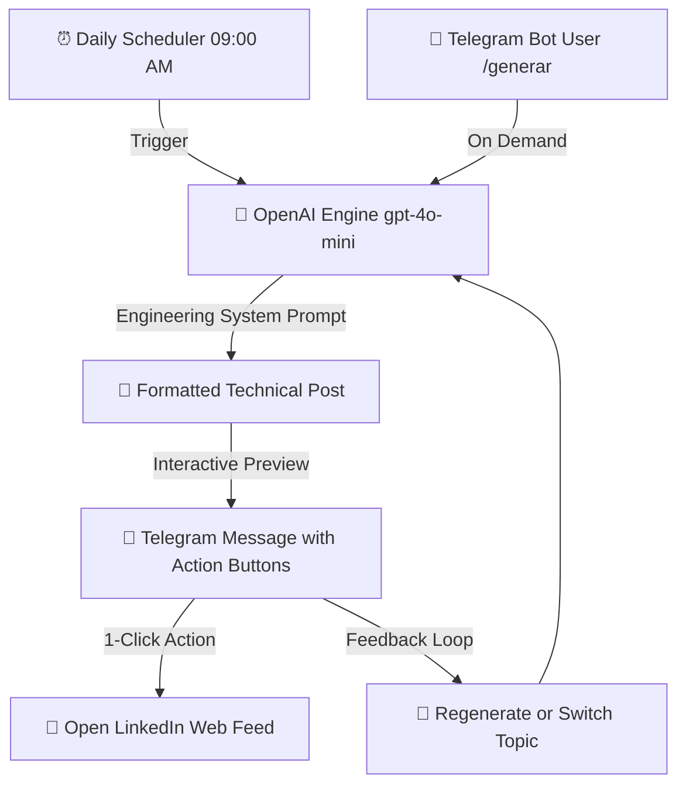

# 🤖 Autonomous LinkedIn Content AI Agent

[](https://www.python.org/)
[](https://openai.com/)
[](https://core.telegram.org/bots/api)
[](https://www.docker.com/)
[](LICENSE)

An autonomous background daemon and Telegram bot designed for software engineers. It generates high-impact, authentic technical publications based on real software engineering architectures (Symfony, React, Docker, n8n, OpenAI, distributed systems) and dispatches daily drafts directly to Telegram with one-click publishing to LinkedIn.

---

## 📌 Architecture & Workflow



---

## ✨ Features

- **🎯 Technical Authority Prompting:** Eliminates marketing clichés and generic phrases. Generates authentic posts with a structured engineering framework: *Initial technical challenge → Architectural solution → Lessons learned & trade-offs → Open question to the tech community*.
- **📱 Telegram Command & Callback Interface:**
  - `/generar` or `🚀 Generar Post Ahora`: Generate an immediate technical post draft.
  - `/temas` or `💡 Ver Temas`: Browse and select from curated architecture topics (Docker Compose, Concurrency, API Platform, OpenAI Function Calling, MCP).
  - Inline buttons: One-click link to LinkedIn, regenerate, or choose another topic.
- **⏰ Autonomous Daily Scheduler:** Automatically delivers a fresh post suggestion every morning at 09:00 AM (configurable via `.env`).
- **🐳 Docker & Docker Compose Ready:** Fully containerized for one-command deployment to any VPS, cloud server, or local environment.
- **⚡ Lightweight & Resilient:** Uses clean modular Python with zero bloated dependencies, resilient UTF-8 BOM parsing, and persistent state management.

---

## 🛠️ Tech Stack

- **Core:** Python 3.12
- **AI Engine:** OpenAI API (`gpt-4o-mini`)
- **Messaging:** Telegram Bot API (Long Polling & Webhooks compatible)
- **Containerization:** Docker & Docker Compose
- **Testing:** Python `unittest` suite

---

## 🚀 Quick Start

### 1. Prerequisites
- Python 3.10+ or Docker
- OpenAI API Key ([platform.openai.com](https://platform.openai.com/))
- Telegram Bot Token (from [@BotFather](https://t.me/BotFather))

### 2. Clone the Repository
```bash
git clone https://github.com/pablocorrea1404-wq/linkedin-ai-agent.git
cd linkedin-ai-agent
```

### 3. Configure Environment Variables
Copy the `.env.example` file to `.env`:
```bash
cp .env.example .env
```
Edit `.env` with your API credentials:
```env
OPENAI_API_KEY=sk-proj-your-openai-api-key
TELEGRAM_BOT_TOKEN=123456789:ABCdefGhIJKlmNoPQRstuVWXyz
OPENAI_MODEL=gpt-4o-mini
DAILY_SCHEDULE_HOUR=9
```

### 4. Run Locally
```bash
# Install dependencies
pip install -r requirements.txt

# Run the autonomous agent
python main.py
```

### 5. Or Run with Docker Compose
```bash
docker compose up -d
```

---

## 🧪 Running Tests

Verify prompt integrity, state persistence, and error handling:
```bash
python -m unittest discover tests
```

---

## 📂 Project Structure

```text
linkedin-ai-agent/
├── src/
│   ├── __init__.py
│   ├── config.py           # Environment variables, topic catalog, and state handling
│   ├── generator.py        # OpenAI API client and prompt engineering engine
│   ├── telegram_bot.py     # Telegram Bot polling, command routing, and keyboard UI
│   └── scheduler.py        # Background daily timer thread
├── tests/
│   └── test_generator.py   # Unit tests
├── .env.example            # Template for required environment variables
├── .gitignore              # Ignores secrets (.env) and temporary runtime state
├── Dockerfile              # Production container build
├── docker-compose.yml      # Multi-environment deployment orchestration
├── main.py                 # Application daemon entrypoint
├── requirements.txt        # Python dependencies
└── README.md               # Technical documentation
```

---

## 👤 Author

**Pablo Correa Ribeiro**
- **Role:** Full Stack Developer & AI Automation Engineer
- **LinkedIn:** [linkedin.com/in/pablo-correa-ribeiro-2462552a9](https://www.linkedin.com/in/pablo-correa-ribeiro-2462552a9/)
- **GitHub:** [@pablocorrea1404-wq](https://github.com/pablocorrea1404-wq)

---

## 📄 License

This project is licensed under the MIT License - see the [LICENSE](LICENSE) file for details.
